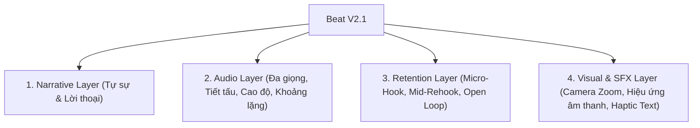

# ĐẶC TẢ BIÊN KỊCH BEAT & KỸ THUẬT GIỮ CHÂN KHÁN GIẢ V2.1
> **OmniVideo Studio Local** — Tiêu Chuẩn Kịch Bản & Nghe-Nhìn Đa Tầng (Retention & Multi-Voice)

---

## 1. TỔNG QUAN HỆ THỐNG BEAT V2.1

Trong OmniVideo Studio, **Beat** không đơn thuần là một đoạn văn bản (text), mà là một **Đơn vị Nghe-Nhìn-Cảm Xúc Độc Lập**. Mỗi Beat tích hợp đầy đủ 4 lớp thông tin:



---

## 2. NĂM KHUÔN MẪU BIÊN KỊCH CHUYÊN BIỆT (5 SCRIPTWRITING ARCHETYPES)

| Mã Archetype | Thể loại | Thời lượng lý tưởng | Cấu trúc phân cảnh chính | Xưởng đề xuất |
| :--- | :--- | :--- | :--- | :--- |
| `storytelling` | Cổ tích / Drama / Tự sự | 60s – 120s | `exposition` $\to$ `inciting_incident` $\to$ `rising_conflict` $\to$ `rehook_crisis` $\to$ `climax` $\to$ `resolution_moral` | Xưởng 3 (Whiteboard) |
| `explainer` | Giải thích kiến thức / Tech | 30s – 60s | `hook` $\to$ `problem` $\to$ `solution` $\to$ `rehook_deepdive` $\to$ `impact_proof` $\to$ `cta` | Xưởng 2 (Remotion) |
| `versus` | So sánh đối đầu A vs B | 45s – 75s | `dilemma_hook` $\to$ `contender_a` $\to$ `contender_b` $\to$ `twist_rehook` $\to$ `final_verdict` $\to$ `cta_debate` | Xưởng 2 (Remotion) |
| `mythbuster` | Lật tẩy lầm tưởng / Sai lầm | 35s – 60s | `myth_hook` $\to$ `common_mistake` $\to$ `shocking_truth` $\to$ `evidence_breakdown` $\to$ `actionable_rule` $\to$ `share_cta` | Xưởng 1 / Xưởng 2 |
| `news` | Tin tức nóng / Thời sự | 30s – 50s | `breaking_hook` $\to$ `key_facts` $\to$ `context_analysis` $\to$ `rehook_reaction` $\to$ `future_outlook` $\to$ `discussion_cta` | Xưởng 1 (HyperFrames) |

---

## 3. KỸ THUẬT GIỮ CHÂN KHÁN GIẢ (RETENTION ENGINEERING)

Thuật toán TikTok và YouTube Shorts phân phối video dựa trên **Tỉ lệ xem hết (Completion Rate)**. Hệ thống Beat v2.1 cài đặt sẵn các điểm giữ chân:

### 3.1. Micro-Hook (0–3s đầu)
- Tuyệt đối không chào hỏi dài dòng.
- Đi thẳng vào một câu khẳng định gây tò mò, số liệu giật mình, hoặc câu hỏi đánh trúng nỗi đau.
- Ví dụ: *"90% lập trình viên đang dùng Redis sai cách mà không hề hay biết."*

### 3.2. Mid-Video Re-hook (Giây thứ 20–30)
- Điểm rơi chú ý thường xảy ra ở giữa video. Hệ thống kích hoạt thuộc tính `"isRehook": true` đi kèm:
  - Lời thoại kích thích: *"Nhưng điều bất ngờ nhất vẫn nằm ở phía sau..."* hoặc *"Đừng vội mừng, lỗi chí mạng xuất hiện ngay tại đây."*
  - SFX: `dramatic_boom` hoặc `glitch_error`.
  - Camera: `zoom_in_punch` để phá vỡ nhịp đều đặn (Pattern Interrupt).

### 3.3. Open Loop (Vòng lặp mở)
- Đặt ra câu hỏi hoặc phần thưởng bí mật ở Beat 1, nhưng chỉ giải đáp ở Beat 5 (áp chót).
- Khiến người xem buộc phải nán lại đến cuối video để thỏa mãn sự tò mò.

---

## 4. HỆ THỐNG ĐA GIỌNG ĐỌC & ĐIỀU BIẾN NHỊP ĐỘ (MULTI-VOICE & PACING)

Mỗi Beat có thể chỉ định một diễn viên lồng tiếng riêng biệt hoặc điều chỉnh cảm xúc:

| Tham số | Ý nghĩa | Ví dụ thực tế |
| :--- | :--- | :--- |
| `voiceId` | Mã giọng Edge TTS tiếng Việt | `vi-VN-NamMinhNeural` (Nam chuẩn), `vi-VN-HoaiMyNeural` (Nữ ngọt ngào) |
| `rate` | Tốc độ đọc | `+10%` khi gay cấn dồn dập, `-5%` khi đúc kết sâu lắng |
| `pitch` | Cao độ giọng | `+2Hz` giọng tươi vui, `-5Hz` giọng phản diện / nghiêm trọng |
| `pauseAfterMs` | Khoảng lặng nghỉ sau câu | `400ms` tạo cảm giác hồi hộp trước khi lật mở cú twist |
| `speaker` | Tên nhân vật thể hiện | `"Người dẫn chuyện"`, `"Cô Tấm"`, `"Cám"`, `"Chuyên gia"` |

---

## 5. MẪU JOB JSON CHUẨN V2.1 ĐẦY ĐỦ THUỘC TÍNH

Dưới đây là một Job JSON hoàn chỉnh áp dụng Archetype `versus` với đa giọng đọc và hiệu ứng retention:

```json
{
  "jobId": "job-mysql-vs-redis-60s",
  "title": "MySQL vs Redis: Cuộc Chiến Tốc Độ & Bền Vững",
  "workshop": "explainer",
  "archetype": "versus",
  "targetPlatform": "tiktok",
  "canvas": { "width": 1080, "height": 1920, "fps": 30 },
  "voice": {
    "provider": "edge-tts",
    "voiceId": "vi-VN-NamMinhNeural",
    "speed": 1.0,
    "rate": "+0%"
  },
  "beats": [
    {
      "id": "beat_01",
      "role": "dilemma_hook",
      "rawText": "Lưu dữ liệu thì nên chọn MySQL hay Redis để hệ thống không sập khi có triệu người truy cập?",
      "cues": {
        "camera": "zoom_in_punch",
        "sfx": "whoosh_impact",
        "hapticText": "CHỌN AI?"
      },
      "visual": {
        "headline": "MySQL vs Redis",
        "subhead": "Chọn database nào khi tải tăng đột biến?"
      }
    },
    {
      "id": "beat_02",
      "role": "contender_a",
      "rawText": "MySQL là vua quan hệ, dữ liệu lưu chặt chẽ trên ổ cứng, an toàn tuyệt đối với chuẩn ACID.",
      "voice": {
        "voiceId": "vi-VN-NamMinhNeural",
        "rate": "+2%",
        "speaker": "Chuyên gia Backend"
      },
      "cues": { "sfx": "ding_idea" },
      "visual": {
        "headline": "MySQL: Bền Vững Tuyệt Đối",
        "subhead": "Chuẩn ACID, dữ liệu không sợ mất khi mất điện"
      }
    },
    {
      "id": "beat_03",
      "role": "contender_b",
      "rawText": "Nhưng khi cần đọc ghi dưới 1 mili-giây, Redis mới là quái vật nhờ chạy trực tiếp trên RAM!",
      "voice": {
        "voiceId": "vi-VN-HoaiMyNeural",
        "rate": "+8%",
        "pitch": "+2Hz",
        "speaker": "Kỹ sư Tối ưu"
      },
      "cues": {
        "camera": "shake_impact",
        "sfx": "dramatic_boom",
        "hapticText": "RAM SIÊU TỐC"
      },
      "visual": {
        "headline": "Redis: Tốc Độ Ánh Sáng",
        "value": "< 1ms",
        "label": "Đọc ghi trực tiếp trên RAM"
      }
    },
    {
      "id": "beat_04",
      "role": "twist_rehook",
      "rawText": "Nhưng đừng nhầm lẫn! Đem Redis làm database chính là thảm họa mất dữ liệu khi sập nguồn.",
      "cues": {
        "isRehook": true,
        "camera": "zoom_in_punch",
        "sfx": "glitch_error",
        "hapticText": "SAI LẦM CHÍ MẠNG"
      },
      "voice": {
        "rate": "+5%",
        "pauseAfterMs": 450
      },
      "visual": {
        "headline": "Lỗi Chí Mạng",
        "subhead": "RAM mất điện là mất trắng dữ liệu!"
      }
    },
    {
      "id": "beat_05",
      "role": "final_verdict",
      "rawText": "Công thức chuẩn kiến trúc: Dùng MySQL làm nguồn chân lý, kết hợp Redis làm bộ đệm Caching phía trước.",
      "cues": { "sfx": "whoosh_impact" },
      "visual": {
        "headline": "Kiến Trúc Hoàn Hảo",
        "bullets": [
          "MySQL: Lưu trữ vĩnh viễn (Source of Truth)",
          "Redis: Đệm tăng tốc 10x (In-Memory Cache)"
        ]
      }
    },
    {
      "id": "beat_06",
      "role": "cta_debate",
      "rawText": "Hệ thống của bạn đang kết hợp hai con quái vật này như thế nào? Để lại bình luận bên dưới nhé!",
      "cues": { "sfx": "ding_idea" },
      "visual": {
        "headline": "Thảo Luận",
        "subhead": "Bạn đang dùng Database nào? Bình luận ngay!"
      }
    }
  ]
}
```
