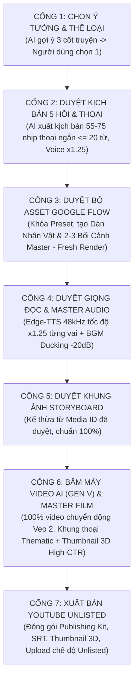

# 🎬 QUY CHUẨN ĐIỆN ẢNH TOÀN NĂNG (CINEMATIC PRODUCTION STANDARDS)
## BỘ QUY TẮC BẮT BUỘC DÀNH CHO TẤT CẢ DỰ ÁN PHIM HOẠT HÌNH 3D & DONGHUA

> **LƯU Ý DÀNH CHO AI AGENT:** Đây là văn bản quy chuẩn tối cao và bất di bất dịch của toàn bộ hệ sinh thái sản xuất phim OmniVideo Studio (Xưởng 4: `workshop-cinematic`). Khi người dùng yêu cầu làm phim ở **"cấp độ điện ảnh"** (cinematic grade) hoặc sản xuất bất kỳ tập phim nào, AI **BẮT BUỘC** phải tuân thủ 100% các nguyên tắc bên dưới. Tuyệt đối không được rút gọn, không được lặp cảnh, và không được hạ chuẩn chất lượng.

---

## 1. NGUYÊN TẮC VÀNG VỀ NHỊP PHIM & GÓC MÁY (PACING & SHOT COUNT)

### 1.1. Thời lượng trung bình mỗi cảnh (Average Shot Length - ASL) & Tốc Độ Voice x1.25
- **Chuẩn điện ảnh hoạt hình quốc tế:** **3.5 giây – 6.0 giây / shot quay**.
- **QUY CHUẨN VOICE x1.25 TOÀN HỆ THỐNG:** Giọng đọc video **luôn luôn được đặt ở mức x1.25** (`rate='+25%'`).
  - Thoại dứt khoát, súc tích, hiện đại và cuốn hút, triệt tiêu cảm giác đều đều buồn ngủ.
  - Mỗi câu thoại rút ngắn lại (tương đương 3.5s – 5.5s), đồng nghĩa **số lượng shot quay phân cảnh sẽ tăng lên** tương ứng để bám sát chuyển động và đổi góc máy liên tục.
  - **Không sao cả:** Việc tăng số lượng shot cho phép **thời lượng video có thể dài ra thoải mái và kịch bản có thể triển khai vô cùng chi tiết, đào sâu kiến thức/cốt truyện** mà người xem vẫn say mê theo dõi từ đầu đến cuối.
- Mỗi shot quay chỉ phục vụ **duy nhất một nhịp cảm xúc, một câu thoại hoặc một cử chỉ hành động**. Khi nhân vật dứt lời hoặc đối phương phản ứng, **bắt buộc phải đổi góc máy**.

### 1.2. Định lượng số Shot quay bắt buộc theo thời lượng tập phim (Voice x1.25)
Tuyệt đối không dùng 10-15 hình ảnh tĩnh/video để kéo dài một tập phim 5 phút. Bảng định lượng bắt buộc:

| Thời lượng phim | Định dạng | Số shot tối thiểu (Voice x1.25) | Số shot tối ưu (Cinematic Grade) |
| :--- | :--- | :---: | :---: |
| **1 Phút** (60s) | Teaser / Shorts / Trailer | **12 shots** | **14 – 16 shots** |
| **3 Phút** (180s) | Phim ngắn / Phân đoạn cao trào | **30 shots** | **35 – 45 shots** |
| **5 Phút** (300s) | Tập phim tiêu chuẩn (Standard Episode) | **55 shots** | **60 – 75 shots** |
| **10 Phút** (600s) | Tập phim điện ảnh dài (Master Episode) | **100 shots** | **110 – 130 shots** |

---

## 2. NGUYÊN TẮC BẮT BUỘC: 100% SHOTS PHẢI SINH VIDEO AI (GEN V) — TUYỆT ĐỐI CẤM ZOOMPAN ẢNH TĨNH

> ⚠️ **MANDATORY POLICY FOR VIDEO GENERATION (GEN V):**
> Mọi shot quay trong toàn bộ tập phim **BẮT BUỘC PHẢI LÀ VIDEO CHUYỂN ĐỘNG AI THỰC SỰ (`GEN V`)** do Google Flow (Veo 2 `veo_3_1_i2v_lite` hoặc Omni Flash `abra_i2v_*s`) tạo ra từ `start_image_media_id`.
> 
> ⛔ **CẤM HOÀN TOÀN:**
> - Tuyệt đối không được lấy ảnh tĩnh (`GEN I`) rồi dùng bộ lọc `zoompan` / Ken Burns của FFmpeg để giả lập video điện ảnh.
> - `zoompan` trên ảnh tĩnh chỉ tạo ra chuyển động 2D giật giật, nhân vật bị đóng băng (mắt không chớp, tóc và vạt áo không bay, miệng không động đậy, kiếm khí không dao động), phá hủy hoàn toàn trải nghiệm điện ảnh 3D.
> - **Ảnh tĩnh (`GEN I`) CHỈ ĐƯỢC DÙNG LÀM KHUNG HÌNH KHỞI ĐẦU (START FRAME)** để đưa vào API `/api/flow/generate-video` (`GEN V`).

---

## 3. NGUYÊN TẮC BẮT DI BẤT DỊCH: ZERO-LOOP MANDATE (TUYỆT ĐỐI CẤM LẶP CLIP)

> ⛔ **CẤM HOÀN TOÀN:** Không bao giờ sử dụng cờ `-stream_loop` trên video clip Veo 2 / AI để lặp đi lặp lại một chuyển động nhằm "bù" cho đoạn thoại dài 20–30 giây. Người xem sẽ lập tức nhận ra sự lặp lại (tua đi tua lại), phá vỡ hoàn toàn trải nghiệm điện ảnh.

### Cách xử lý đúng khi gặp đoạn hội thoại dài:
Nếu một đoạn thoại giữa 2 nhân vật dài 24 giây, trong khi mỗi clip Veo 2 chỉ tạo được tối đa 6–8 giây:
- **KHÔNG ĐƯỢC:** Tạo 1 clip 8s rồi loop 3 lần = 24s.
- **BẮT BUỘC:** Chia đoạn thoại đó thành **4 shot quay độc lập (mỗi shot 6s)** theo kỹ thuật điện ảnh:
  1. **Shot A (0s - 6s):** Trung cảnh (Medium Shot) nhân vật đang nói câu mở đầu.
  2. **Shot B (6s - 12s):** Cận cảnh phản ứng (Reaction Close-up) người nghe đang siết chặt nắm tay hoặc cau mày.
  3. **Shot C (12s - 18s):** Góc quay qua vai (Over-the-Shoulder) người nói tung ra lời tuyên bố quyết định.
  4. **Shot D (18s - 24s):** Đặc tả (Insert Shot) chuôi kiếm rung lên hoặc toàn cảnh (Wide Shot) không khí căng thẳng bao trùm.

---

## 4. HỆ THỐNG GÓC MÁY ĐỐI THOẠI ĐIỆN ẢNH (SHOT/REVERSE-SHOT SYSTEM)

Trong bất kỳ phân cảnh có 2 nhân vật trở lên giao tiếp, phải luân chuyển qua 5 góc máy điện ảnh:

```
[1. Toàn Cảnh Establishing] (3-5s) 
           │
           ▼
[2. Góc Qua Vai OTS] (4-6s) ──► [3. Trung Cận Nhân Vật Nói] (4-6s)
           ▲                                │
           │                                ▼
[5. Đặc Tả Chi Tiết Insert] (2-4s) ◄── [4. Cận Cảnh Phản Ứng Reaction] (3-5s)
```

1. **Toàn cảnh không gian (Establishing / Wide Shot):** Giới thiệu kiến trúc, địa hình, tương quan vị trí giữa các phe phái, tạo dựng khí quyển (sấm sét, sương mù, ánh trăng).
2. **Góc quay qua vai (Over-The-Shoulder - OTS):** Ống kính đặt sau vai nhân vật A nhìn sang nhân vật B. Tạo cảm giác khán giả đang đứng ngay trong cuộc đối thoại.
3. **Trung cận nhân vật nói (Medium Close-Up):** Bắt trọn biểu cảm gương mặt, ánh mắt kiên định hoặc khinh miệt của người đang phát biểu.
4. **Cận cảnh phản ứng (Reaction Shot):** Bắt cận gương mặt người nghe. Cảm xúc điện ảnh nằm ở phản ứng của người nghe nhiều hơn là người nói (nghiến răng, tròng mắt co rút, mỉm cười cay đắng).
5. **Đặc tả chi tiết (Insert / Cutaway Shot):** Giọt mồ hôi lăn trên gò má, ngón tay khẽ chạm vào chuôi kiếm, vạt áo rách bay trong gió tuyết, phù văn trên kiếm cổ phát sáng.

---

## 5. CHIẾN LƯỢC ĐỒNG BỘ KHẨU HÌNH & LIP-SYNC 3 TẦNG (3-TIER LIP-SYNC ARCHITECTURE)

Trong quy trình làm phim bằng AI hiện đại, AI **KHÔNG CẦN** người dùng phải tốn công nặn blendshapes/visemes hay dựng hàng trăm asset cử động (đi, chạy, cười, khóc...) như thời 3D CGI thủ công cũ. Thay vào đó, việc đồng bộ cử động miệng và biểu cảm khi 2 nhân vật đối thoại được xử lý thông minh qua **3 Tầng Kỹ Thuật**:

### 5.1. Tầng 1: Thủ Pháp Cắt Góc Điện Ảnh (Cinematic Cutting - Chiếm 70% thời lượng đối thoại)
Khán giả điện ảnh chú ý vào cảm xúc tổng thể và phản ứng câu chuyện thay vì chỉ dán mắt vào môi của người nói. Khi 2 nhân vật giao tiếp:
- **Establishing Shot (Toàn cảnh):** Hai nhân vật đứng trong không gian lớn. Camera đặt xa, không thấy rõ khẩu hình.
- **Over-The-Shoulder (Góc qua vai - OTS):** Camera đặt sau gáy người đang nói, ống kính hướng thẳng vào người đối diện. Khán giả nghe tiếng thoại nhưng mắt nhìn gương mặt người nghe.
- **Reaction Shot (Cận cảnh phản ứng):** Nhân vật A nói câu đe dọa, camera cắt sang nhân vật B đang nghiến răng, trừng mắt giận dữ hoặc run rẩy. Người nghe ngậm miệng, biểu cảm kịch tính cực đại.
- **Insert Shot (Đặc tả chi tiết):** Bàn tay siết chặt chuôi kiếm, mạch máu nổi lên, tà áo tung bay, đan điền phát sáng.

### 5.2. Tầng 2: Cấu Trúc Prompt Sinh Khẩu Hình Tự Nhiên Của Veo (Native Viseme Speaking Motion - Chiếm 25%)
Tại các shot **Trung Cận (Medium Close-Up)** trực diện người đang nói:
- Trong Video Prompt của Veo 2/3, bắt buộc thêm cấu trúc điều khiển khẩu hình và cơ mặt:
  `[Character Name] speaks fiercely, mouth moving naturally with emotional conviction, jaw and facial expressions intensely shifting as he delivers his words.`
- AI Veo sẽ tự động mô phỏng cơ hàm, vành môi mở theo nhịp độ phát âm, ánh mắt biểu cảm mà không cần gắn bất kỳ khung xương 3D nào.

### 5.3. Tầng 3: Khớp Âm Tiết Chính Xác Bằng AI Audio-Driven Lip-Sync (Precision Visemes - Dành cho các shot Siêu Cận Cảnh)
Ở các shot **Đặc tả Siêu Cận Mặt (Extreme Close-Up)** cần vành môi co giãn khớp chính xác 100% từng nguyên âm tiếng Việt (A, O, E, U, M, P...):
- Hệ thống hỗ trợ tích hợp mô hình **Neural Lip-Sync** (như `LivePortrait`, `SadTalker`, `MuseTalk`, hoặc `Wav2Lip`).
- Đầu vào: Video khuôn mặt nhân vật đã render + File âm thanh Edge-TTS tiếng Việt.
- Cơ chế: AI tự động phân tích phổ âm thanh (Mel-spectrogram) và biến dạng vành môi nhân vật khớp từng mili-giây với từng từ phát ra.
- **Quy tắc phân loại Shot trong Storyboard:**
  - `SHOT_TYPE: WIDE / OTS / REACTION / INSERT` ➔ Bỏ qua Lip-sync trực diện (Tầng 1).
  - `SHOT_TYPE: MEDIUM_SPEAKING` ➔ Veo Native Speaking Prompt (Tầng 2).
  - `SHOT_TYPE: CLOSEUP_CRITICAL_SPEAKING` ➔ Kích hoạt Audio-Driven Lip-Sync (Tầng 3).

---

## 6. QUY CHUẨN ÂM THANH & LỒNG TIẾNG STUDIO VIỆT NAM

### 6.1. Bộ máy Lồng tiếng (Voice Engine) & Tốc Độ Voice x1.25 Bắt Buộc
- Sử dụng **Microsoft Edge-TTS Vietnamese Neural** (`vi-VN-NamMinhNeural` và `vi-VN-HoaiMyNeural`).
- Phát âm 100% chuẩn tiếng Việt có dấu, rõ ràng từng âm tiết, không ngọng, không méo tiếng.
- **TỐC ĐỘ VOICE BẮT BUỘC LUÔN Ở MỨC x1.25 (`rate='+25%'`):**
  - Giúp nhịp phim nhanh dứt khoát, hiện đại, không chậm chạp.
  - Thoại gọn hơn đồng nghĩa trong một tập phim sẽ có nhiều shot phân cảnh hơn (ví dụ 100–130 shot cho tập 10 phút), tạo điều kiện cho kịch bản được viết chi tiết hơn, đào sâu nhiều góc độ kỹ thuật / tình tiết hấp dẫn.

### 6.2. Bộ thông số điều biến màu giọng từng nhân vật (Character Voice Presets - Nền x1.25)
Tuyệt đối không để tất cả nhân vật có cùng một âm vực và tốc độ. Bảng thông số chuẩn (đã tích hợp chuẩn nền x1.25):

| Nhân vật / Vai diễn | Giọng mẫu Neural | Điều chỉnh Cao độ (Pitch) | Tốc độ (Rate chuẩn x1.25) | Âm sắc & Phong thái |
| :--- | :--- | :---: | :---: | :--- |
| **Nam chính thiếu niên** | `vi-VN-NamMinhNeural` | `-4Hz` | `+22%` | Trầm ấm, kiên nghị, nội lực, không hấp tấp. |
| **Đối thủ trẻ / Phản diện** | `vi-VN-NamMinhNeural` | `+3Hz` | `+30%` | The thé, cao giọng, nhanh, đắc thắng, cay nghiệt. |
| **Gia chủ / Trưởng bối lão giả** | `vi-VN-NamMinhNeural` | `-6Hz` | `+20%` | Trầm đục, uy nghiêm, lạnh lùng, mang áp lực uy quyền. |
| **Nữ chính / Muội muội** | `vi-VN-HoaiMyNeural` | `+1Hz` | `+23%` | Trong trẻo, thanh tao, dịu dàng, giàu tình cảm. |
| **Người Dẫn Chuyện (Narrator)** | `vi-VN-NamMinhNeural` | `-2Hz` | `+25%` | Khách quan, sử thi, dứt khoát, tạo cảm giác truyền thuyết. |

### 6.3. Tiêu chuẩn Kỹ thuật Âm thanh Master (Audio Mastering)
- **Tần số lấy mẫu:** **48,000 Hz** (chuẩn điện ảnh 48kHz, không dùng 22kHz hay 44.1kHz nén thấp).
- **Kênh âm thanh:** **Stereo 2 kênh (2.0)**.
- **Bộ nén & Bitrate:** **AAC @ 192 kbps** trở lên.
- **Cân bằng âm lượng (Audio Layering & Ducking):**
  - **Voice Track (Thoại):** `0 dB` (trọng tâm chính, rõ ràng, không bị nhạc đè, kèm Voice Boost khi mix master).
  - **BGM (Nhạc nền điện ảnh):** Tự động ducking giảm xuống `-18 dB` đến `-20 dB` khi có thoại; tự động dâng lên `-6 dB` ở đoạn chuyển cảnh và cao trào chiến đấu.
  - **SFX (Tiếng động môi trường / Kiếm khí):** Đặt tại các mốc va chạm, tiếng kiếm rút, tiếng sấm nổ.

---

## 7. CÔNG THỨC KỊCH BẢN 5 HỒI TỰ ĐỘNG & ĐỘ DÀI CÂU THOẠI VÀNG (AUTO-BEAT SCREENPLAY MATRIX)

Để người mới bắt đầu không cần phải tự cân đối nhịp độ phim, AI Đạo Diễn tự động phân rã kịch bản mọi tập phim theo ma trận 5 Hồi chuẩn điện ảnh quốc tế:

| Hồi (Act) | Tên Phân Đoạn | Thời lượng % | Nhiệm vụ Kịch bản | Quy chuẩn Thoại & Hình ảnh |
| :---: | :--- | :---: | :--- | :--- |
| **Hồi 1** | **Khởi Động & Thế Giới** | 15% | Đặt bối cảnh, giới thiệu nhân vật chính trong trạng thái khởi đầu hoặc biến cố lớn. | 6 – 10 shots, góc quay Establishing toàn cảnh hùng vĩ. |
| **Hồi 2** | **Xung Đột Nhen Nhóm** | 25% | Kẻ địch hoặc thử thách xuất hiện. Tin dữ, áp lực đè nặng lên nhân vật chính. | 14 – 20 shots, đối thoại qua lại góc OTS & Trung cảnh. |
| **Hồi 3** | **Đối Đầu Trực Diện** | 30% | Mâu thuẫn đỉnh điểm. Kẻ địch hống hách ép người quá đáng, nhân vật chạm đáy chịu đựng. | 18 – 25 shots, nhịp cắt nhanh, Cận cảnh phản ứng giận dữ. |
| **Hồi 4** | **Cao Trào & Bùng Nổ** | 20% | Phản kích bất ngờ! Tuyệt chiêu, bộc lộ sức mạnh bí mật, đảo ngược tình thế. | 12 – 16 shots, góc máy Insert đặc tả kiếm khí/nội lực, va chạm cực đại. |
| **Hồi 5** | **Hạ Màn & Cliffhanger** | 10% | Lời tuyên chiến, mở ra hành trình tập sau, để lại cảm giác tò mò tột độ cho người xem. | 6 – 8 shots, góc thấp Low-angle nhìn về chân trời hoàng hôn. |

### Quy Tắc Độ Dài Câu Thoại Vàng (Golden Dialogue Length Rule):
- **Độ dài tối đa:** Mỗi câu thoại trong kịch bản **tuyệt đối không dài quá 20 từ tiếng Việt** (tương đương **3.5s – 5.5s** âm thanh ở tốc độ x1.25, khớp hoàn hảo với 1 shot Veo 2 / Omni Flash).
- **Quy tắc bẻ thoại (Auto-Splitting):** Nếu kịch bản có đoạn độc thoại dài: AI đạo diễn **bắt buộc phải tự động bẻ thành 2–3 câu ngắn**, mỗi câu tương ứng với một góc máy luân phiên khác nhau:
  - *Câu 1 (4.0s):* Trung cận người nói phát biểu.
  - *Câu 2 (3.5s):* Cận cảnh người nghe cau mày, cắn chặt môi run rẩy.
  - *Câu 3 (4.5s):* Đặc tả nắm đấm siết chặt hoặc góc qua vai (OTS) tiếp tục dứt lời.

---

## 8. BỘ MÃ PHONG CÁCH KHÓA CHẶT (LOCKED ART STYLE PRESETS)

Để triệt tiêu 100% tình trạng "lúc Chibi lúc người thật", hệ thống quy định 3 bộ mã phong cách bất di bất dịch. Mỗi dự án phim **chỉ được chọn DUY NHẤT một mã phong cách** cho toàn bộ tác phẩm:

### 8.1. `PRESET_DONGHUA_3D` (Chuẩn Tiên hiệp / Huyền huyễn điện ảnh)
- **Visual DNA Prompt:**
  `Epic 3D Donghua animation style, realistic human body proportions 1:7, cinematic lighting, Octane Render, Unreal Engine 5 aesthetic, intricate silk robes, volumetric mist, photorealistic textures.`
- **Negative Prompt (Bắt buộc):**
  `chibi, deformed proportions, large head, cartoonish caricature, blind box, toy figurine, 2D anime, flat shading.`

### 8.2. `PRESET_CHIBI_3D` (Chuẩn Hài hước / Mini Dễ thương)
- **Visual DNA Prompt:**
  `3D stylized Chibi aesthetic, blind box figurine proportion 1:3, cute expressive face, porcelain skin, warm vibrant lighting, miniature diorama render, smooth glossy finish.`
- **Negative Prompt (Bắt buộc):**
  `realistic human proportion 1:7, photorealistic, tall slender adult, gritty dark realism, live action.`
- **Quy tắc:** 100% nhân vật, người qua đường, và kẻ địch từ đầu đến cuối đều phải là Chibi 1:3.

### 8.3. `PRESET_ANIME_25D` (Chuẩn Anime Điện Ảnh Nhật Bản)
- **Visual DNA Prompt:**
  `Makoto Shinkai style, high-end 2.5D cel-shaded cinematic anime, lush detailed hand-painted backgrounds, dramatic god rays, vibrant color grading.`
- **Negative Prompt (Bắt buộc):**
  `chibi, 3D clay, doll, realistic human photo, muddy colors.`

---

## 9. TRƯỜNG QUAY ẢO CỐ ĐỊNH & MASTER PLATES (VIRTUAL SETS & ZERO DRIFT)

Nhằm chấm dứt tình trạng bối cảnh bị trôi dạt (mỗi shot sinh ra một căn phòng, một khu vườn khác nhau):

### 9.1. Giới Hạn Trường Quay Mỗi Tập (Virtual Set Cap)
- Mỗi tập phim (5–10 phút) chỉ được phép có **tối đa 2 đến 3 bối cảnh chính** (Master Sets). Ví dụ:
  - Bối cảnh 1: *Đại Điện Lâm Gia / Tru Tiên Đài (Ngoại cảnh nguy nga)*.
  - Bối cảnh 2: *Gian Phế Viện của Nam Chính (Nội cảnh rách nát)*.
  - Bối cảnh 3: *Vách Núi Hoàng Hôn / Hậu Sơn (Ngoại cảnh tĩnh lặng)*.

### 9.2. Tạo Bản Mẫu Bối Cảnh Toàn Năng (Master Environment Plates)
- Trước khi quay, AI phải dùng Google Flow tạo ảnh toàn cảnh 4K Establishing Plate cho từng bối cảnh.
- **Khóa Media ID Bối Cảnh:** Mọi shot quay sau đó **CHỈ ĐƯỢC PHÉP CHUYỂN DỊCH GÓC MÁY BÊN TRONG BẢN MẪU NÀY** (lia máy, zoom cận vào góc phòng, xoay góc OTS).
- **Cấm Tuyệt Đối:** Không được tự ý sinh ra địa điểm lạ không có trong kịch bản (ví dụ: đang ở trong phế viện tự nhiên sinh ra chòi vọng lâu ngoài vườn).

---

## 10. BỘ LỌC DỊCH THUẬT ĐIỆN ẢNH AN TOÀN (CINEMATIC PROMPT TRANSFORMER CHO GOOGLE FLOW)

Các hệ thống AI Video hiện đại (như Google Flow / Veo 2) có bộ lọc an toàn rất khắt khe. Các từ khóa hành động/bạo lực tiên hiệp kinh điển (*giết, phế, tát, đánh, máu, bãi tha ma*) sẽ bị hệ thống âm thầm chặn, gây lỗi `Media not found` hoặc treo tiến trình.

AI Đạo Diễn **bắt buộc phải tự động dịch thuật** các tình tiết kịch tính sang ngôn ngữ điện ảnh vật lý và không khí mà Google Flow không bao giờ chặn:

| Từ ngữ kịch bản gốc (Dễ bị AI chặn) | Ngôn ngữ dịch thuật điện ảnh cho Google Flow (An toàn 100%) |
| :--- | :--- |
| **Cái tát nảy lửa, bạt tai** | `Sudden burst of spiritual wind blowing across the room, silk sleeves fluttering aggressively, camera whip pan` |
| **Đuổi đánh, đánh đập dã man** | `Stern guards pointing staves outward, commanding authority, intimidating postures, cold mist swirling` |
| **Hộc máu mồm, đầy máu me** | `Exhausted warrior kneeling on one knee, breath misting in cold air, trembling hand resting on broken sword` |
| **Bãi tha ma, vứt xác** | `Desolate misty mountain ridge under twilight, withered ancient trees, solemn atmospheric mystery` |
| **Gương mặt hung ác, độc ác** | `Intense piercing glare, sharp eyebrow arch, arrogant haughty smile, dramatic high-contrast shadow` |
| **Giết sạch không tha, chặt đầu** | `Lethal cold sword drawn from scabbard, reflection of lightning gleaming on steel blade, swift forward dash` |
| **Đấm bay đối thủ, vỡ xương** | `Shockwave radiating across stone ground, dust exploding outward, opponent sliding backward defensively` |

---

## 11. QUY CHUẨN THIẾT KẾ KHUNG THOẠI THEMATIC & KÍCH CỠ CHUẨN CYBER CHATBOX (LOẠI BỎ 100% HỘP ĐEN PHỤ ĐỀ CŨ)

### 11.1. Xóa Bỏ 100% Hộp Đen Phụ Đề Cũ (Zero Black Box Mandate)
- ⛔ **CẤM HOÀN TOÀN:** Tuyệt đối không sử dụng bộ lọc phụ đề bounding box màu đen đặc thô dày (`BorderStyle=3` của FFmpeg) vốn chiếm tới 30–40% màn hình, đè bẹp bối cảnh 3D và nhân vật.
- Mọi video xuất xưởng **bắt buộc phải sử dụng Khung thoại Nghệ thuật (Thematic Dialogue Box)** được may đo tương ứng với phong cách của từng dòng phim.

### 11.2. May Đo Khung Thoại Theo Art Style Của Từng Dòng Phim
Hộp phụ đề không chỉ để đọc chữ, mà là một lớp giao diện (UI Layer) tôn vinh phong cách mỹ thuật của tác phẩm:

| Phong cách phim (Art Style) | Thiết kế Khung Thoại (Dialogue Box) | Huy Hiệu Người Nói (Speaker Pill Badge) | Font & Typography Thoại |
| :--- | :--- | :--- | :--- |
| **Công nghệ / Cyberpunk / Robot Chibi** *(Giải Mã Tech, MCP, Byte)* | Hộp kính bán trong suốt (`rgba(11, 15, 23, 0.88)`), viền Cyan Neon 2px (`#00DAF5`), bo góc công nghệ. | Pill Badge Cyan `#00DAF5`, chữ đen `#0A1623` in hoa: `BÉ BYTE (AI AGENT)`, `BÉ BYTE (CHATBOT)`. | Arial Bold / Segoe UI Bold trắng `#FFFFFF`, cỡ 30–34px, căn giữa. |
| **Tiên Hiệp / Donghua 3D** *(Huyền huyễn, Cổ phong)* | Khung thoại hoa văn cổ phong, viền hoàng kim hoặc ngọc bích bán trong suốt, góc mây cách điệu. | Badge Hổ phách / Vàng kim `#FFB300`, viền ngọc, tên nhân vật phong thái kiếm hiệp: `TIÊU VIÊM`, `LÂM ĐỘNG`. | Font thư pháp / Khang Hy thanh thoát, chữ trắng viền vàng kim mờ. |
| **Anime 2.5D / Cel-Shaded** *(Visual Novel, JRPG)* | Khung thoại Frosted Glass gradient mờ mịn màng phong cách JRPG hiện đại, góc bo tròn mềm mại. | Pill Badge tối giản, màu pastel theo màu tóc/mắt của nhân vật đang phát biểu. | Sans-serif hiện đại (Inter, Roboto Bold), trắng tinh tế. |

### 11.3. Bảng Kích Thước Chuẩn Bất Di Bất Dịch (Lấy Cyber Chatbox Làm Quy Chuẩn Gốc)
Mọi khung thoại thiết kế cho video ngang 16:9 (1920 × 1080) **BẮT BUỘC TUÂN THỦ CHÍNH XÁC CÁC THÔNG SỐ VÀNG CỦA CYBER CHATBOX**:

- **Khung Canvas Master:** `1920 × 1080` (Full HD).
- **Chiều rộng hộp thoại (`box_w`):** **`1600px`** (chiếm ~83% chiều ngang màn hình, chừa lề cân đối `160px` mỗi bên).
- **Chiều cao hộp thoại (`box_h`):** **`120px – 135px`** (gọn gàng thanh thoát, chỉ chiếm ~11–12% chiều cao màn hình, giải phóng 88% không gian chính diện cho visual 3D và nhân vật).
- **Vị trí căn ngang (`box_x`):** Căn chính giữa khung hình (`box_x = (1920 - 1600) // 2 = 160`).
- **Vị trí cách đáy (`box_y`):** Cách mép đáy màn hình **`40px – 45px`** (`box_y = 1080 - box_h - 45 = 900 - 915`).
- **Bán kính bo góc (`radius`):** **`16px – 18px`**.
- **Speaker Pill Badge (Huy hiệu người nói):**
  - *Vị trí:* Đặt ở góc trên bên trái hộp thoại, chờm nhẹ lên viền trên (`badge_x = box_x + 24`, `badge_y = box_y - 16px .. -18px`).
  - *Bo góc:* `8px – 10px`.
  - *Padding:* Ngang `16px`, dọc `6px`.
  - *Chữ huy hiệu:* In hoa đậm (Bold Uppercase), cỡ `18px – 22px`.
- **Dialogue Typography (Chữ thoại nội dung):**
  - *Cỡ chữ:* **`30px – 34px Bold`** (đảm bảo hiển thị trọn vẹn 1 dòng đẹp mắt cho các câu thoại ngắn <= 20 từ).
  - *Màu chữ:* Trắng tinh khiết `#FFFFFF`.
  - *Căn chỉnh:* Căn chính giữa cả chiều ngang lẫn chiều dọc bên trong hộp thoại.
  - *Đổ bóng:* Text shadow offset `(2, 2)` màu đen mờ `rgba(0, 0, 0, 0.85)` tăng tối đa độ tương phản và độ đọc rõ trên mọi khung hình 3D chuyển động.

---

## 12. QUY CHUẨN THUMBNAIL 3D ĐIỆN ẢNH (CINEMATIC 3D THUMBNAIL MANDATE — CẤM 100% SLIDE 2D)

> ⚠️ **MANDATORY POLICY FOR YOUTUBE PACKAGING:**
> Thumbnail là yếu tố quyết định tới **70% tỷ lệ nhấp chuột (Click-Through-Rate - CTR)** của video trên thuật toán YouTube. Một video chất lượng 3D điện ảnh tuyệt đối không thể khoác lên một chiếc "áo ngoài" slide bài giảng nghèo nàn.

### 12.1. Lệnh Cấm Tuyệt Đối (Zero Flat Slide Policy):
- ⛔ **CẤM HOÀN TOÀN:**
  - Không bao giờ thiết kế thumbnail ở dạng slide 2D phẳng, nền vẽ hình học đơn điệu hoặc chèn sơ đồ bảng biểu chi chít chữ nhỏ.
  - Tuyệt đối cấm lỗi font emoji dẫn đến các ký tự ô vuông rác `□` (như `□ KỶ NGUYÊN...`, `□ Tự làm...`). Mọi biểu tượng phải là hình học vector hoặc pill badge được vẽ sạch sẽ.

### 12.2. Khai Thác Trực Tiếp Asset 3D Độc Quyền Của Tập Phim:
- Bắt buộc trích xuất **Frame 3D đẹp nhất (Beauty Shot / Hero Shot)** từ chính các shot đã render của tập phim (ví dụ: Frame Bé Byte 3D lơ lửng với jetpack phát sáng trong phòng lab, hoặc cận cảnh mascot cổ điển bị giam trong lồng kính).
- Giữ nguyên độ sắc nét 4K / Octane Render / Unreal Engine 5, tạo cảm giác phim hoạt hình điện ảnh chiếu rạp đẳng cấp.

### 12.3. Quy Tắc Typography High-CTR (Đọc Rõ Trên Mọi Màn Hình Mobile):
1. **Câu Hook Cực Ngắn:** Không quá 4–6 từ (ví dụ: `AI AGENT LÀ GÌ?`, `KHI AI TỰ HÀNH ĐỘNG!`).
2. **Cỡ Chữ Cực Đại:** Tiêu đề chính đạt kích thước **80px – 110px Bold**.
3. **Màu Sắc Neon Tương Phản:** Phối hợp màu Cyan Neon (`#00E5FF`) và Vàng Kim (`#FFD700`) trên nền tối gradient.
4. **Viền Đen Dày Cực Hạn (Stroke 5px – 7px):** Chữ luôn có viền đen dày để tách biệt hoàn toàn khỏi nền 3D phía sau, đảm bảo người dùng lướt nhanh trên điện thoại di động vẫn nhận diện được nội dung trong 0.3 giây.
5. **Nhận Diện Kênh & Badge:** Logo kênh ở góc trên bên trái, pill tag chủ đề (`KỶ NGUYÊN TỰ CHỦ 2026`) và các huy hiệu tính năng bo góc tinh tế.

---

## 13. QUY CHUẨN CỔNG 7 — XUẤT BẢN YOUTUBE KHÔNG CÔNG KHAI (UNLISTED PUBLISHING PROTOCOL)

> ⚠️ **MANDATORY POLICY FOR YOUTUBE PUBLISHING & PRIVACY:**
> Khi video hoàn thiện Cổng 6 (Master Film & 3D Thumbnail), hệ thống kích hoạt **Cổng 7** nhằm tự động hóa toàn bộ công đoạn xuất bản lên YouTube mà vẫn đảm bảo tính an toàn và quyền kiểm soát tuyệt đối của người dùng.

### 13.1. Đóng Gói Bộ Tài Liệu Xuất Bản (Publishing Kit Packaging):
Hệ thống tự động biên soạn và tạo file `publishing_kit.json` (hoặc `metadata.json`) bao gồm:
1. **Tiêu đề chuẩn SEO (Click-Worthy & SEO Title):** Ngắn gọn dưới 70 ký tự, chứa từ khóa chính, câu hook gây tò mò, mang phong cách giật gân tương phản cao.
2. **Timestamps & Chapters:** Tự động tính toán mốc thời gian bắt đầu từ `00:00` dựa trên cấu trúc các nhịp thoại (Beats) và 5 Hồi của kịch bản (ví dụ: `00:00 Mở đầu kịch tính`, `01:15 Khủng hoảng`, `03:40 Cao trào đột phá`).
3. **Thẻ Tags & Chủ Đề:** Bộ 15–25 tags chuyên sâu về thể loại phim, phong cách đồ họa, và chủ đề cốt lõi.
4. **Phụ Đề Tiếng Việt Chuẩn UTF-8 (`.srt`):** Đồng bộ chính xác theo từng nhịp thoại Edge-TTS, hỗ trợ người xem bật phụ đề CC trên mọi nền tảng.
5. **Gắn Thumbnail 3D Điện Ảnh High-CTR:** Sử dụng ảnh thumbnail 3D đã sinh ở Cổng 6, có kích thước 1920x1080, typography viền đen cực hạn và badge nhận diện thương hiệu.

### 13.2. Quy Tắc Bất Di Bất Dịch: Mặc Định Chế Độ Không Công Khai (`unlisted`):
- **TUYỆT ĐỐI CẤM:** Không tự ý xuất bản ở chế độ `public` trực tiếp khi chưa có chỉ định rõ ràng từ người dùng.
- **CHẾ ĐỘ `UNLISTED` BẢO MẬT:** Video tải lên YouTube luôn đặt trạng thái riêng tư là `unlisted`. Điều này giúp:
  - Người dùng có thể xem trước bản render trực tiếp trên trình phát YouTube thực tế để kiểm định âm thanh, màu sắc, phụ đề và độ phân giải 1080p/4K.
  - Tránh các rủi ro về bản quyền, lỗi kiểm duyệt sơ suất, hoặc lộ tài liệu nội bộ trước giờ phát sóng chính thức.
  - Người dùng chỉ cần vào YouTube Studio chuyển trạng thái sang `public` hoặc lên lịch chiếu (Schedule) khi hoàn toàn hài lòng.

### 13.3. Tích Hợp Lệnh CLI Điều Phối:
```bash
# Xuất bản tự động ở chế độ unlisted sau khi render hoàn tất
python scripts/studio_pipeline.py --job <job_id> --publish-youtube

# Tùy biến trạng thái nếu người dùng yêu cầu tường minh
python scripts/studio_pipeline.py --job <job_id> --publish-youtube --privacy unlisted
```

---

## 14. QUY TẮC FRESH-RENDER (ZERO ASSET REUSE)

> ⚠️ **MANDATORY POLICY FOR ASSET UNIQUENESS & ZERO CONTAMINATION:**
> Để mỗi tập phim giữ vững bản sắc nghệ thuật độc bản và tránh sự nhàm chán lặp lại, OmniVideo Studio áp dụng nghiêm ngặt quy tắc **Fresh-Render**.

### 14.1. Lệnh Cấm Tuyệt Đối:
- ⛔ **CẤM HOÀN TOÀN việc tái sử dụng asset (video, ảnh, âm thanh) của job cũ sang job mới:**
  - Không được copy ảnh phân cảnh, chân dung nhân vật hoặc background của tập trước để "tiết kiệm thời gian" hay "tiết kiệm quota".
  - Không được dùng lại các đoạn video AI Veo 2 / Omni Flash của các dự án trước. Mỗi kịch bản, mỗi bối cảnh và mỗi cảm xúc phải được khởi tạo mới hoàn toàn theo linh hồn của câu chuyện mới.

### 14.2. Cách Ly Không Gian Lưu Trữ (Job Isolation Architecture):
- Mỗi job sản xuất phải có thư mục làm việc và xuất bản riêng biệt theo `job_id` (ví dụ: `output/cinematic/<job_id>/` hoặc `assets/<job_id>/`).
- **Dọn dẹp tiền kỳ (Pre-render Cleanup):** Trước khi bấm máy render hình ảnh (Cổng 3/5) hoặc video AI (Cổng 6), hệ thống phải kiểm tra và làm sạch toàn bộ cache tạm, đảm bảo không có file rác hoặc asset cũ còn sót lại trong thư mục job.
- **Tính độc bản 100%:** Toàn bộ tư liệu từ Establishing Plates, Character Anchors, Storyboard Keyframes cho đến Video AI chuyển động phải được tạo mới bằng các câu prompt chuyên biệt kế thừa trực tiếp từ kịch bản của chính job đó.

---

## 15. QUY TRÌNH 7 CỔNG SẢN XUẤT TOÀN NĂNG (THE 7-GATE PRODUCTION PROTOCOL)

Để người dùng mới hoàn toàn làm chủ sản phẩm mà không cần lo lắng về lỗi kỹ thuật, toàn bộ quy trình sản xuất được kiểm soát bởi **7 Cổng Sản Xuất & Phê Duyệt Tuần Tự**:



### Chi Tiết Từng Cổng Phê Duyệt:

- **CỔNG 1 (Concept & Genre Gate):**
  - AI đề xuất 3 ý tưởng/thế giới quan khác biệt cùng mã Preset phù hợp.
  - Người dùng bấm chọn 1 ý tưởng để tiếp tục.
- **CỔNG 2 (Script & Dialogue Gate):**
  - AI viết kịch bản phân bổ theo ma trận 5 Hồi, kiểm soát mỗi câu thoại dưới 20 từ, tối ưu tốc độ voice x1.25.
  - Người dùng đọc duyệt nội dung và lời thoại trước khi làm tài sản.
- **CỔNG 3 (Asset Approval Gate - BẮT BUỘC & FRESH-RENDER):**
  - AI dùng Google Flow tạo hình ảnh Dàn Nhân Vật (Character Anchors) và 2–3 Bối Cảnh (Master Environment Plates) hoàn toàn mới cho job hiện tại.
  - Trình bày trực quan cho người dùng. **Chỉ khi người dùng duyệt mới bước sang bước tiếp theo**.
- **CỔNG 4 (Audio Voice Gate):**
  - Chạy Edge-TTS 48kHz cho các nhân vật với tốc độ chuẩn x1.25 theo đúng thông số Pitch/Rate đã định hình.
  - Kiểm tra BGM Ducking (-20dB) và độ biểu cảm giọng đọc.
- **CỔNG 5 (Storyboard Consistency Gate):**
  - AI sinh loạt 55–75 ảnh phân cảnh bằng cách kế thừa trực tiếp Media ID từ Cổng 3.
  - Đảm bảo 100% không bị lệch nét mặt hay trôi dạt địa điểm.
- **CỔNG 6 (Master Film Assembly Gate):**
  - Đưa ảnh vào Google Flow để sinh 100% video AI chuyển động thực (`GEN V`).
  - FFmpeg tự động ráp toàn bộ timeline, phủ khung thoại Thematic Chatbox, hòa âm BGM/SFX, xuất bản master film chuẩn 1080p điện ảnh.
  - **Tự động xuất Thumbnail 3D Điện Ảnh High-CTR** khai thác frame đẹp nhất của tập phim.
- **CỔNG 7 (YouTube Unlisted Publishing Gate):**
  - Tự động đóng gói Publishing Kit (Title SEO, Chapters, Tags, mô tả).
  - Xuất phụ đề tiếng Việt `.srt` và đính kèm Thumbnail 3D High-CTR.
  - Tải video master MP4 lên YouTube ở chế độ riêng tư `unlisted` (không công khai).
  - Cung cấp link xem trước an toàn để người dùng kiểm tra thành phẩm cuối cùng.

---

## 16. LỜI HỨA CỐT LÕI VỚI KHÁN GIẢ

Mỗi tập phim sản xuất từ hệ thống OmniVideo Studio phải đạt chuẩn chất lượng thưởng thức của phim hoạt hình chiếu mạng:
- **Nghe rõ từng chữ tiếng Việt thân thương, biểu cảm sống động.**
- **Hình ảnh chuyển đổi liên tục, góc máy đa dạng, không góc chết.**
- **Không một giây nào bị tua đi tua lại một cách rẻ tiền.**
- **100% video chuyển động AI thực sự, không dùng zoompan ảnh tĩnh.**
- **Khẩu hình và biểu cảm tự nhiên, không cần tốn công tạo asset 3D thủ công.**
- **Nhân vật và bối cảnh nhất quán tuyệt đối từ giây đầu tiên đến giây cuối cùng.**
