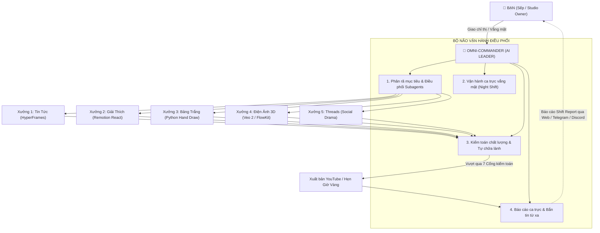

# 🏛 OMNIVIDEO STUDIO — BẢN THIẾT KẾ AI LEADER & LỘ TRÌNH TIỆN ÍCH STUDIO

> **Tài liệu đặc tả kiến trúc:** Định hình năng lực của **Omni-Commander AI (Leader Agent)** và các tiện ích nâng cao trải nghiệm người dùng phục vụ vận hành tự động hóa studio sản xuất video đa phân xưởng.
> **Ngày phê duyệt:** 24/10/2026.

---

## 📑 MỤC LỤC
1. [Phần 1: Omni-Commander AI — Leader Quản Trị Tự Hành](#-phần-1-omni-commander-ai--leader-quản-trị-tự-hành)
   - [1.1. Tầm nhìn & Vai trò Leader](#11-tầm-nhìn--vai-trò-leader)
   - [1.2. Bốn Năng Lực Cốt Lõi Của Leader](#12-bốn-năng-lực-cốt-lõi-của-leader)
   - [1.3. Ba Phương Thức Tương Tác Giữa Bạn Và Leader](#13-ba-phương-thức-tương-tác-giữa-bạn-và-leader)
2. [Phần 2: Bốn Tiện Ích Đột Phá Cho Trải Nghiệm Người Dùng](#-phần-2-bốn-tiện-ích-đột-phá-cho-trải-nghiệm-người-dùng)
   - [2.1. Hẹn Giờ Đăng "Khung Giờ Vàng" (Smart Schedule)](#21-hẹn-giờ-đăng-khung-giờ-vàng-smart-schedule)
   - [2.2. Tùy Biến Thumbnail Trực Quan (Kéo Thả & Trích Frame)](#22-tùy-biến-thumbnail-trực-quan-kéo-thả--trích-frame)
   - [2.3. Huy Hiệu Đã Đăng & Chuông Báo Ngoài Màn Hình](#23-huy-hiệu-đã-đăng--chuông-báo-ngoài-màn-hình)
   - [2.4. Bộ Đóng Gói Đa Nền Tảng (TikTok/Reels + ZIP Kit)](#24-bộ-đóng-gói-đa-nền-tảng-tiktokreels--zip-kit)
3. [Phần 3: Lộ Trình Triển Khai (Roadmap)](#-phần-3-lộ-trình-triển-khai-roadmap)

---

## 🤖 PHẦN 1: OMNI-COMMANDER AI — LEADER QUẢN TRỊ TỰ HÀNH

### 1.1. Tầm nhìn & Vai trò Leader
* **Tên định danh:** **Omni-Commander AI** (Tổng Đạo Diễn & Giám Đốc Sản Xuất Tự Hành).
* **Vị trí:** Đứng vị trí chỉ huy tối cao trong workspace, có quyền điều động tất cả các công cụ, phân xưởng (Workshops 1 - 5) và các Subagent chuyên trách (Biên kịch, Âm thanh Edge-TTS, Kỹ sư Video Veo/Remotion, QA Auditor, YouTube Publisher).
* **Mục tiêu:** Giúp chủ Studio không phải làm các tác vụ cơ bắp, chỉ cần giao mục tiêu tổng thể hoặc để máy chạy tự động trong lúc đi ngủ/đi làm việc khác.

---

### 1.2. Bốn Năng Lực Cốt Lõi Của Leader

#### 🎯 Năng Lực 1: Tiếp Nhận & Phân Rã Lệnh Tự Nhiên (High-Level Task Delegation)
* Nhận một câu lệnh đa nhiệm tự nhiên từ bạn và tự động bẻ nhỏ thành danh sách công việc logic:
  * *Ví dụ chỉ đạo:* *"Leader ơi, hôm nay làm cho tôi 2 video Threads về drama bạn cùng phòng, và 1 video giải thích về DeepSeek R1 16:9. Làm xong thì lên lịch đăng 20:00 tối nay."*
* **Leader tự động thực thi:**
  * Bóc tách thành `job_threads_01`, `job_threads_02` (điều phối sang Xưởng 5) và `job_explainer_deepseek` (điều phối sang Xưởng 2).
  * Phân bổ tài nguyên máy tính tuần tự để tránh nghẽn CPU/GPU.
  * Tự động sinh kịch bản chuẩn cấu trúc và ngữ âm tiếng Việt.

#### 🌙 Năng Lực 2: Vận Hành Tự Động Khi Vắng Mặt (Night Shift Autonomous Mode)
* **Tự săn tìm nội dung (Auto-Crawl):** Tự động quét RSS tin tức công nghệ, top trending Threads, Reddit hoặc danh mục chủ đề được bạn định cấu hình sẵn.
* **4 Vũ Khí Vượt Tường Lửa Cloudflare & Chống Anti-Bot Của Leader:**
  1. *Lợi thế IP Dân Cư Local & Stealth Browser:* Studio chạy trên chính máy tính cá nhân của bạn với IP mạng gia đình (Residential IP có uy tín tuyệt đối với Cloudflare) kết hợp Playwright/Puppeteer Stealth (tự xóa `navigator.webdriver`, mô phỏng di chuyển chuột Bézier tự nhiên, gắn User Profile Chrome đã đăng nhập sẵn).
  2. *Cửa hậu Mobile Internal GraphQL API:* Giả lập User-Agent ứng dụng di động (Threads/Instagram/TikTok iOS/Android App) để gọi thẳng vào các endpoint GraphQL nội bộ của nền tảng, nhận JSON thô trong <100ms mà không qua web HTML, triệt tiêu nguy cơ dính Cloudflare Turnstile hay JS challenge.
  3. *Tuyến đường cao tốc RSS & Public APIs:* Báo chí công nghệ (TechCrunch, The Verge, Hacker News, Dev.to, VnExpress, GenK) đều mở 100% cổng RSS XML và REST APIs không tường lửa cho máy đọc tự động.
  4. *Công cụ tự giải challenge dự phòng:* Tích hợp proxy local FlareSolverr hoặc Firecrawl MCP để tự động giải các màn hình kiểm tra Bot nếu gặp phải.

* **Radar Tự Động Săn Repo GitHub Trending (GitHub Trending Auto-Scout) Cho Xưởng 2 & Xưởng 3:**
  * **1. Chu kỳ quét Radar:** Mỗi 12 giờ hoặc định kỳ 07:00 sáng mỗi ngày, Leader tự động gọi GitHub REST API v3 (`api.github.com/search/repositories?q=stars:>300+created:>7d&sort=stars`) và phân tích trang `github.com/trending` (lọc Python, TypeScript, Rust, Go, C++).
  * **2. Bộ lọc Velocity (Tốc độ bùng nổ sao):**
    - Lọc các repo tăng **$\ge 300 - 500$ stars trong 24 giờ qua** (hoặc $\ge 2,000$ stars/tuần).
    - Tập trung các chủ đề: *AI Agents, Local LLM & Quantization, Web Frameworks, CLI & Developer Tools, High-Performance Databases, Vector Search*.
  * **3. Bóc tách tư liệu tự động (Deep Semantic Extraction):**
    - *Phân tích `README.md`:* Trích xuất 4 thông tin vàng:
      1. Bài toán giải quyết (Problem statement - Công cụ cũ bị nghẽn ở đâu?).
      2. Tính năng đột phá nhất (Game-changer feature).
      3. 3-5 dòng code khởi chạy mẫu (Quickstart code snippet).
      4. Bảng số liệu Benchmark tốc độ (ví dụ: nhanh hơn tool cũ 5-10 lần).
    - *Chụp ảnh giao diện thật (Puppeteer Headless):* Chụp Header GitHub (tên repo, avatar tác giả, số stars/forks thời điểm bùng nổ), sơ đồ kiến trúc hệ thống, bảng so sánh tính năng.
  * **4. Phân luồng sản xuất tự động sang 2 Phân Xưởng:**
    - **Phân xưởng 2: Video Giải Thích Code (`workshop-explainer` - Remotion React 19 + Tailwind v4):**
      - *Phù hợp với:* Thư viện code, tool lập trình, framework, CLI, package npm/pip.
      - *Dàn dựng:* Đặt ảnh chụp GitHub repo trong **Browser Frame / Laptop 3D Mockup**, hiệu ứng **Typing Code Animation** từng dòng kèm âm thanh gõ phím cơ clicky, biểu đồ thanh so sánh benchmark tốc độ mượt mà.
      - *Format:* 9:16 Shorts/TikTok hoặc 16:9 YouTube Video 3-5 phút.
    - **Phân xưởng 3: Video Vẽ Tay Bảng Trắng (`workshop-whiteboard` - Python OpenCV Hand-Draw):**
      - *Phù hợp với:* Mô hình kiến trúc phức tạp, giải thuật AI, hệ thống phân tán, paper nghiên cứu lý thuyết.
      - *Dàn dựng:* Bàn tay phác họa từng khối kiến trúc hệ thống (Client $\rightarrow$ Server $\rightarrow$ Cache $\rightarrow$ DB), nét mực đậm chất tư duy, hiệu ứng bàn tay xóa bảng (Eraser Wipe) chuyển cảnh mượt mà, giọng đọc truyền cảm sâu sắc.
      - *Format:* 16:9 YouTube Video hoặc 9:16 Shorts.
  * **5. Tự sinh bộ tiêu đề Viral High-CTR:**
    - *"Repo GitHub Này Vừa Đạt 5.000 Sao Chỉ Sau 24 Giờ! Có Gì Hot?"*
    - *"Tạm Biệt Tool X: Thư Viện Mã Nguồn Mở Này Nhanh Hơn Gấp 10 Lần!"*
    - *"Deep-dive Kiến Trúc Của [Tên Repo]: Tại Sao Nó Đang Thống Trị GitHub Tuần Này?"*
* **Tự động duyệt 7 Cổng (Auto-Pilot 7 Gates):**
  * Thay vì dừng lại bắt người dùng bấm chuột duyệt ở Cổng 3 (Asset) và Cổng 5 (Storyboard), Leader sẽ đóng vai trò Đạo diễn duyệt tự động dựa trên các tiêu chí chất lượng nghiêm ngặt (Fresh Render, Prompt Transformer an toàn, ASL 3.5s - 6.0s, Khung thoại Thematic).
  * Đưa thẳng video qua Cổng 6 (Render Master MP4) và Cổng 7 (Nạp vào hàng đợi YouTube).

#### 🛡 Năng Lực 3: Kiểm Duyệt Chất Lượng & Tự Chữa Lành (Quality Gatekeeper & Self-Healing)
* **Soi lỗi tự động (Automated QA Audit):**
  * *Âm thanh:* Kiểm tra file lồng tiếng Edge-TTS không bị nuốt chữ cuối, có đủ +0.35s tail padding, âm lượng $\ge -14$ LUFS, nhạc nền BGM ducking chuẩn.
  * *Hình ảnh:* Kiểm tra không có khung hình đen (Black Frame), video 100% là chuyển động AI (GEN V), phụ đề không tràn viền, thumbnail sắc nét.
* **Tự chữa lành (Self-Healing Loop):**
  * Nếu một shot quay bị gián đoạn mạng hoặc Google Flow timeout, Leader **tự động retry tối đa 3 lần** với cơ chế giãn cách thời gian (Exponential Backoff) hoặc đổi prompt dự phòng mà **không bao giờ để tiến trình bị đứng hình hoặc dừng ngang**.

#### 📋 Năng Lực 4: Báo Cáo Ca Trực & Cảnh Báo Từ Xa (Remote Shift Briefing)
* **Báo cáo tóm tắt ca trực (Shift Report):**
  * Khi bạn mở máy tính, Leader gửi ngay báo cáo tổng quan: Số video hoàn tất, thời lượng, link YouTube Unlisted/Scheduled, dung lượng và trạng thái sức khỏe hệ thống.
* **Bắn tin thông báo từ xa (Remote Push):**
  * Hỗ trợ gửi thông báo qua **Telegram Bot cá nhân** hoặc **Discord Webhook** của bạn. Khi có video hoàn thành hoặc khi phát hiện cảnh báo quan trọng, Leader lập tức gửi tin nhắn về điện thoại của bạn.

---

### 1.3. Ba Phương Thức Tương Tác Giữa Bạn Và Leader
1. **Nói chuyện trực tiếp trong Chat IDE (Antigravity):** Giao việc, tham vấn chiến lược hoặc yêu cầu chỉnh sửa kịch bản.
2. **Thanh chỉ đạo "Leader Command Bar" trên Web Dashboard (`localhost:3333`):** Một ô nhập lệnh trung tâm giúp bạn ra lệnh trực tiếp trên giao diện đồ họa.
3. **Lập lịch tự động (Cron Schedule):** Cài đặt khung giờ Leader tự động thức dậy sản xuất (ví dụ: 06:00 sáng làm bản tin nóng, 23:00 đêm dọn dẹp cache và dựng phim điện ảnh).

---

## ⚡ PHẦN 2: BỐN TIỆN ÍCH ĐỘT PHÁ CHO TRẢI NGHIỆM NGƯỜI DÙNG

### 2.1. Hẹn Giờ Đăng "Khung Giờ Vàng" (Smart Schedule)
* **Vấn đề:** Đăng video không đúng thời điểm sẽ bị thuật toán bóp tương tác, phí công sản xuất.
* **Giải pháp:**
  * Thêm chế độ **"Lên Lịch Đăng (Scheduled)"** vào Modal YouTube API.
  * Tích hợp 3 nút 1-click chọn **Khung Giờ Vàng Shorts Việt Nam**:
    * `[ ☀️ 11:30 Trưa ]` — Giờ nghỉ trưa của sinh viên và nhân viên văn phòng.
    * `[ 🌙 20:00 Tối ]` — Giờ cao điểm xem video thư giãn sau bữa tối.
    * `[ 🦉 22:30 Đêm ]` — Giờ lướt Shorts/TikTok/Threads trước khi ngủ.
  * YouTube Data API sẽ nhận tham số `publishAt` (chuẩn ISO 8601) và tự động mở công khai video đúng khung giờ đã chọn.

### 2.2. Tùy Biến Thumbnail Trực Quan (Kéo Thả & Trích Frame)
* **Vấn đề:** Thumbnail quyết định 80% tỷ lệ nhấp chuột (CTR). Hiện tại thumbnail được chọn mặc định từ render đầu tiên.
* **Giải pháp:**
  * **Kéo - Thả ảnh:** Kéo trực tiếp file ảnh từ máy tính thả vào khung xem trước thumbnail trên modal để thay thế ngay lập tức.
  * **Nút `[ 📸 Trích Frame Đẹp Từ Video ]`:** Hệ thống tự động phân tích và trích xuất 3 khoảnh khắc đắt giá (giây thứ 3 có reaction meme, giây thứ 15 lúc cao trào) để bạn chọn làm ảnh bìa chỉ với 1 click.

### 2.3. Huy Hiệu Đã Đăng & Chuông Báo Ngoài Màn Hình
* **Vấn đề:** Khi thư viện có 30–50 video, bạn rất dễ bị lẫn lộn video nào đã đăng, video nào chưa; và quá trình upload 1 phút khiến bạn phải chờ đợi.
* **Giải pháp:**
  * **Huy hiệu trên thẻ video:** Ngay khi tải lên thành công, thẻ video lập tức gắn huy hiệu đỏ: `🔴 ĐÃ ĐĂNG YOUTUBE • ID: [xxxx]`.
  * **Tác vụ nhanh trên thẻ:** Click vào huy hiệu để mở ngay video trên YouTube hoặc sao chép nhanh link chia sẻ.
  * **Chuông báo hoàn tất (Browser Push Notification):** Khi upload chạm 100%, trình duyệt phát tiếng *"Ting"* nhẹ và hiện thông báo popup góc màn hình: *"Video [Tên] đã lên kênh HanShin thành công!"*, giúp bạn thoải mái chuyển tab làm việc khác.

### 2.4. Bộ Đóng Gói Đa Nền Tảng (TikTok/Reels + ZIP Kit)
* **Vấn đề:** Video 9:16 rất thích hợp để phân phối chéo lên TikTok và Facebook Reels để tối đa hóa lượng người xem.
* **Giải pháp:**
  * Nút `[ 📋 Copy Format TikTok / Reels ]`: Tự động chuyển đổi caption và bộ hashtag sang chuẩn trending của TikTok/Reels.
  * Nút `[ 📦 Tải Gói Publishing Kit (ZIP) ]`: Tự động nén Video MP4 sạch + Thumbnail 4K + File SRT + File Text mô tả vào 1 file ZIP để lưu trữ hoặc gửi cho biên tập viên.

---

## 🚀 PHẦN 3: LỘ TRÌNH TRIỂN KHAI (ROADMAP)

| Giai đoạn | Nội dung trọng tâm | Kết quả bàn giao |
| :--- | :--- | :--- |
| **Giai đoạn 1** | **Tiện ích Dashboard & Xuất bản** | Hẹn giờ Giờ Vàng (`publishAt`), Huy hiệu Đã đăng YouTube, Chuông báo hoàn tất, Kéo-thả Thumbnail, Copy TikTok format. |
| **Giai đoạn 2** | **Bộ não Omni-Commander AI** | Xây dựng Skill Leader phân rã task tự nhiên, bộ điều phối hàng đợi các Xưởng (Multi-Workshop Orchestrator). |
| **Giai đoạn 3** | **Tự hành khi vắng mặt (Night Shift)** | Cơ chế tự động duyệt 7 Cổng (Auto-Pilot), kiểm toán chất lượng âm thanh/hình ảnh, tự chữa lành (Self-Healing Loop). |
| **Giai đoạn 4** | **Báo cáo & Kết nối từ xa** | Leader Mission Control Widget trên Web Dashboard, kết nối Bot Telegram / Discord Webhook gửi báo cáo ca trực về điện thoại. |
