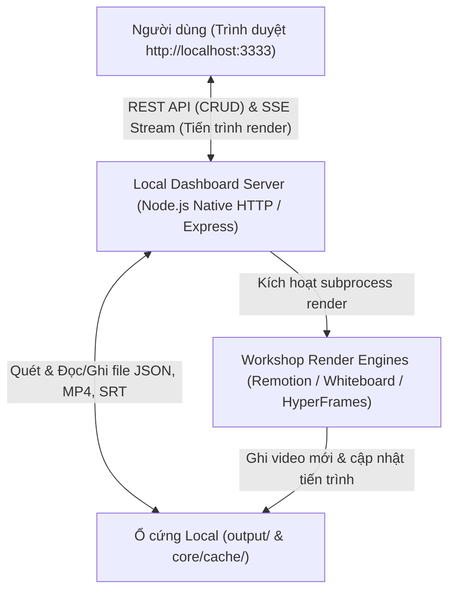

# ĐẶC TẢ THIẾT KẾ: VIDEO LIBRARY DASHBOARD (CRUD & LOCAL WEB PORTAL)
> **OmniVideo Studio Local** — Hệ Thống Quản Lý Kho Video & Kịch Bản Cục Bộ  
> **Ngày:** 2026-10-14 | **Phiên bản:** v2.1 | **Trạng thái:** Chờ phê duyệt

---

## 1. MỤC TIÊU & TỔNG QUAN HỆ THỐNG

### 1.1. Bối cảnh
OmniVideo Studio hiện đã vận hành thành công cả 3 xưởng sản xuất video (`HyperFrames` cho tin tức, `Remotion` cho explainer, `Whiteboard` cho vẽ tay) cùng bộ máy biên kịch 5 Archetype và TTS tiếng Việt. Tuy nhiên, việc kiểm tra video, nghe thử audio, sửa kịch bản và xóa/re-render hiện đang phụ thuộc vào dòng lệnh và mở thư mục thủ công.

### 1.2. Mục tiêu
Xây dựng một **Web Dashboard cục bộ (Local Single-Page Application)** chạy tại cổng `http://localhost:3333`, tích hợp vào menu `[7]` của `studio.bat`/`studio.ps1`:
- 100% Cục bộ (Local-first), không yêu cầu tài khoản hay cloud server.
- Giao diện Dark mode hiện đại, mượt mà, trực quan.
- Đáp ứng trọn vẹn chu trình **CRUD** cho toàn bộ kho video đã tạo.

---

## 2. CÁC TÍNH NĂNG CỐT LÕI (CORE CRUD FEATURES)

### 2.1. Read (Xem & Khám phá kho video)
- **Lưới danh sách video (Video Grid):** Hiển thị thẻ card cho từng video với ảnh bìa (thumbnail), tiêu đề, tên xưởng sản xuất (Badge màu: *Xưởng 1 - Xanh ngọc, Xưởng 2 - Tím Remotion, Xưởng 3 - Vàng Whiteboard*), thời lượng thực tế, ngày tạo và dung lượng tệp.
- **Bộ lọc & Tìm kiếm:**
  - Lọc theo Xưởng: *Tất cả*, *Explainer (Remotion)*, *Whiteboard (Bảng trắng)*, *News (HyperFrames)*.
  - Tìm kiếm theo từ khóa: Tiêu đề, tag, nội dung beat.
  - Sắp xếp: Mới nhất, Cũ nhất, Thời lượng, Kích thước file.
- **Trình phát video nâng cao (Video Player Modal):**
  - Xem video MP4 trực tiếp kèm bật/tắt phụ đề tiếng Việt (WebVTT / SRT).
  - Thanh duyệt Timeline 6 Beat: Bấm vào beat nào sẽ nhảy ngay đến mốc thời gian của beat đó.
  - Nghe thử tệp âm thanh voice-over của từng beat riêng lẻ.

### 2.2. Create (Tạo video mới bằng giao diện trực quan)
- Form tạo kịch bản không cần gõ lệnh:
  - Chọn Xưởng sản xuất (Explainer 9:16, Whiteboard 16:9, News 9:16).
  - Chọn Archetype kịch bản (Storytelling, Explainer, Versus, Mythbuster, News).
  - Chọn Giọng đọc & Tốc độ mặc định.
  - Nhập danh sách Beat hoặc bấm "Sinh kịch bản tự động theo chủ đề".
- Lưu trực tiếp thành `output/jobs/job-<tên>.json`.

### 2.3. Update (Chỉnh sửa kịch bản & Re-render)
- **Kịch bản Editor (Visual & Raw JSON):**
  - Chỉnh sửa lời thoại từng câu, đổi giọng đọc cho từng nhân vật (Multi-voice), đổi hiệu ứng camera và SFX.
  - Kéo thả sắp xếp lại thứ tự các beat.
- **Nút "Re-render Ngay" (1-Click Re-render):**
  - Gọi adapter của xưởng tương ứng để tái tổng hợp TTS cho các câu bị sửa và render lại video thành phẩm.
  - Hiển thị thanh tiến trình (Progress bar) thời gian thực qua Server-Sent Events (SSE).

### 2.4. Delete (Quản lý dung lượng & Dọn dẹp)
- Hộp thoại xác nhận an toàn với 2 chế độ:
  - **Chỉ xóa video thành phẩm:** Giữ lại kịch bản JSON và audio để có thể render lại khi cần.
  - **Xóa toàn bộ (Clean all):** Xóa cả MP4, thumbnail, kịch bản JSON và các tệp cache liên quan.

### 2.5. Export & Download (Xuất bản)
- 1-Click tải về:
  - Tệp video `video.mp4` (Full HD).
  - Ảnh đại diện `thumbnail.png`.
  - Tệp phụ đề đồng bộ `subtitles.srt`.
  - Tệp hợp đồng kịch bản `job.json`.

---

## 3. KIẾN TRÚC KỸ THUẬT (TECHNICAL ARCHITECTURE)



### 3.1. Cấu trúc thư mục mới
```text
dashboard/
├── server.ts              # Máy chủ API cục bộ (Node.js/TypeScript)
├── public/
│   ├── index.html         # Trang giao diện chính (SPA)
│   ├── app.js             # Logic frontend, tương tác API, state
│   ├── styles.css         # Thiết kế UI Dark mode chuẩn Tailwind / Modern CSS
│   └── favicon.ico        # Biểu tượng OmniVideo Studio
```

### 3.2. Đặc tả API RESTful Cục Bộ
- `GET /api/videos`: Quét thư mục `output/jobs/` và `output/` để trả về danh sách toàn bộ video kèm metadata.
- `GET /api/videos/:id`: Trả về chi tiết kịch bản, các beat, file âm thanh, phụ đề và thông số kỹ thuật.
- `POST /api/videos`: Tạo mới kịch bản `job.json`.
- `PUT /api/videos/:id`: Cập nhật kịch bản đã sửa.
- `DELETE /api/videos/:id`: Xóa tệp theo yêu cầu.
- `POST /api/videos/:id/render`: Bắt đầu quá trình render cục bộ, trả về stream SSE để frontend hiển thị tiến trình.
- `GET /media/*`: Static file server hỗ trợ streaming video MP4 (`Accept-Ranges: bytes`) và phát audio tức thì.

---

## 4. TÍCH HỢP VÀO STUDIO MENU

Thêm mục **`[7]`** vào menu chính của [`studio.ps1`](file:///c:/Users/tranh/Documents/Duy/VideoAI/studio.ps1):
```text
 [7] 🌐 Mở Video Library Dashboard (Web UI quản lý kho video & CRUD)
```
Khi người dùng bấm phím `7`:
1. Script kiểm tra cổng 3333, tự động khởi chạy `dashboard/server.ts` nếu chưa chạy.
2. Tự động mở trình duyệt mặc định tại `http://localhost:3333`.

---

## 5. KẾ HOẠCH TRIỂN KHAI THEO CÁC BƯỚC

1. **Bước 1:** Xây dựng `dashboard/server.ts` với Node.js native/Express, cài đặt các endpoint REST API và video streaming.
2. **Bước 2:** Xây dựng giao diện `dashboard/public/index.html` và `app.js` với đầy đủ bộ lọc, Video Player Modal và Beat Timeline.
3. **Bước 3:** Xây dựng Form tạo mới Video Job và Bộ sửa kịch bản Visual JSON Editor.
4. **Bước 4:** Tích hợp tính năng Re-render thời gian thực và Xóa an toàn.
5. **Bước 5:** Thêm mục `[7]` vào `studio.ps1`, kiểm thử toàn diện trên Windows 11 và commit lên GitHub.
