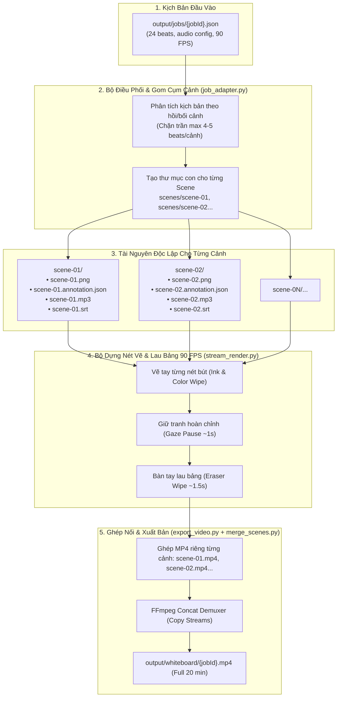

# Thiết Kế Kỹ Thuật: Hệ Thống Video Bảng Trắng Đa Phân Cảnh (Whiteboard Multi-Scene) & Hiệu Ứng Lau Bảng

- **Tác giả:** Omni-Director AI Pair Programming
- **Ngày lập:** 2026-10-15
- **Trạng thái:** Đã phê duyệt (Approved)
- **Phân xưởng áp dụng:** Xưởng 3 (`workshops/workshop-whiteboard`)

---

## 1. Tổng Quan & Vấn Đề Cần Giải Quyết

### 1.1. Hiện trạng
Trước đây, Xưởng 3 (`workshop-whiteboard`) chỉ hoạt động ở chế độ đơn cảnh (Single-Scene):
- Toàn bộ kịch bản video (dù là video ngắn 60 giây hay video dài 20 phút) đều được ép vào một file `scene-01.annotation.json` duy nhất và vẽ trên một file ảnh duy nhất (`scene-01.png`).
- Kết quả là video dài 15–20 phút bị hạn chế về mặt thị giác: chỉ có một bức vẽ duy nhất được đồ nét lại xuyên suốt thời lượng, không thể hiện được sự thay đổi bối cảnh, nhân vật và sự phát triển của cốt truyện theo thời gian.

### 1.2. Mục tiêu kỹ thuật
1. **Hỗ trợ đa bức tranh (Multi-Scene):** Tự động chia kịch bản dài thành nhiều phân cảnh độc lập, mỗi phân cảnh sở hữu bức tranh minh họa, vùng vẽ, audio và phụ đề riêng.
2. **Hiệu ứng lau bảng chân thực (Hand Eraser Wipe):** Chuyển cảnh giữa các bức tranh bằng hoạt cảnh bàn tay cầm khăn/bọt biển lau sạch bảng trắng theo đường lượn sóng zíc-zắc, khôi phục nền giấy nguyên bản trước khi vẽ tranh mới.
3. **Chuẩn khung hình cao (90 FPS):** Duy trì tốc độ khung hình 90 FPS siêu mượt cho toàn bộ luồng vẽ tay, lau bảng và chuyển cảnh.
4. **Hiệu năng và độ tin cậy:** Render phân đoạn (Modular rendering) theo từng cảnh, ghép nối không mất chất lượng (Lossless concatenation qua FFmpeg), cho phép render lại riêng từng cảnh mà không cần chạy lại toàn bộ video 20 phút.

---

## 2. Kiến Trúc Tổng Thể (System Architecture)



---

## 3. Chi Tiết Thiết Kế Kỹ Thuật

### 3.1. Phân Tách Cảnh & Cấu Trúc Dữ Liệu (`job_adapter.py`)

#### Quy tắc nhóm nhịp (Clustering Rule):
Hàm `convert_job_to_whiteboard()` duyệt danh sách `beats` và tạo cảnh mới (`sceneId = f"scene-{scene_idx:02d}"`) khi thỏa mãn một trong các điều kiện sau:
1. `beat.visual.sceneId` thay đổi rõ ràng.
2. `beat.visual.badge` hoặc tiêu đề chương/hồi thay đổi (ví dụ: `CHƯƠNG I` $\rightarrow$ `CHƯƠNG II`).
3. Cảnh hiện tại đã đạt đủ **4 đến 5 beats** (ngưỡng tối đa để đảm bảo canvas 1920x1080 không bị quá tải hình vẽ).

#### Cấu trúc thư mục Scene:
```text
output/whiteboard/{jobId}/
├── scenes/
│   ├── scene-01/
│   │   ├── scene-01.png               # Tranh minh họa phân cảnh 1
│   │   ├── scene-01.annotation.json   # Vùng vẽ của các nhịp trong cảnh 1
│   │   ├── scene-01.mp3               # Audio riêng của cảnh 1 (ghép từ các beats con)
│   │   ├── scene-01.srt               # Phụ đề riêng cảnh 1 (bắt đầu từ 00:00:00)
│   │   ├── IMAGE_PROMPTS.md           # Prompt gợi ý tạo ảnh cho cảnh 1
│   │   ├── video-silent.mp4           # Video vẽ tay không lời (kèm lau bảng cuối cảnh)
│   │   └── scene-01.mp4               # Video hoàn chỉnh cảnh 1 (đã ghép audio)
│   ├── scene-02/
│   └── ...
├── input.mp3                          # Audio tổng hợp toàn bộ video
├── input.srt                          # Phụ đề tổng hợp toàn bộ video
├── {jobId}-thumb.png                  # Thumbnail hiển thị trên Dashboard
└── {jobId}.mp4                        # Video tổng hợp cuối cùng
```

#### Xử lý Phụ đề & Mốc thời gian cục bộ (Local SRT Offset):
Trong mỗi scene, mốc thời gian phụ đề `scene-XX.srt` và mốc vẽ trong `scene-XX.annotation.json` được tính lại bắt đầu từ `00:00:00,000` (Local Timeline), giúp từng cảnh có thể chạy độc lập, xem thử (preview) và biên tập độc lập trong Whiteboard Region Editor.

---

### 3.2. Hiệu Ứng Bàn Tay Lau Bảng (`stream_render.py` / `eraser.py`)

#### Thông số chuyển động:
* **Thời gian lau bảng:** $1.2\text{s} - 1.5\text{s}$ ($\sim 108 - 135\text{ frames}$ ở $90\text{ FPS}$).
* **Hình ảnh công cụ:** Sử dụng hình ảnh bàn tay cầm khăn lau bảng hoặc đầu bọt biển trắng (`assets/eraser-hand.png`).
* **Quỹ đạo lau (Wiping Trajectory):**
  * Quét từ trên xuống dưới theo đường zíc-zắc (Horizontal Zig-Zag with Vertical Progression).
  * Công thức tọa độ x:
    $$x(t) = \text{centerX} + A \cdot \sin(2\pi f t)$$
  * Tọa độ y tịnh tiến tuyến tính từ $0$ đến $H_{\text{canvas}}$.
* **Thuật toán xóa pixel (Canvas Restoration):**
  * Sử dụng Feathered Eraser Mask bán kính $R_{\text{eraser}} \approx 60 - 80\text{ px}$.
  * Tại mỗi frame quét qua, các pixel trên `self.drawn` được hòa trộn dần trở về màu nền giấy kem gốc (`#F6F1E3`).
  * Ở frame cuối của cảnh, `self.drawn` đạt trạng thái tinh tươm $100\%$.
* **Cảnh cuối cùng (Last Scene):** Không kích hoạt hiệu ứng lau bảng mà giữ hình ảnh tĩnh kết thúc (Fade-out).

---

### 3.3. Quản Lý Ảnh Minh Họa Đa Cảnh (`IMAGE_PROMPTS.md` & Asset Resolver)

* **Cơ chế nạp ảnh linh hoạt 2 lớp:**
  1. *Lớp 1 (Có sẵn):* Nếu file `scene-XX.png` đã tồn tại trong thư mục cảnh, renderer nạp trực tiếp.
  2. *Lớp 2 (Dự phòng / Tự động):* Nếu chưa có ảnh riêng cho cảnh đó:
     * Hệ thống tự động sinh file `IMAGE_PROMPTS.md` với prompt chi tiết chuẩn phong cách Notion-doodle (nền kem #F5EBD7, nét phác xám đậm, không chữ).
     * Tự động tận dụng ảnh storyboard tổng thể bằng cách crop phân vùng tương ứng, hoặc tạo khung hình sketch tiêu chuẩn đảm bảo pipeline luôn hoạt động trơn tru.

---

### 3.4. Pipeline Xuất Hoàn Chỉnh (`export_video.py`)

```python
def export_multi_scene_whiteboard(job_id: str, fps: int = 90):
    # 1. Chạy job_adapter.py tạo cây thư mục scenes/
    # 2. Lặp qua từng scene:
    #      a. Nạp / kiểm tra scene-XX.png
    #      b. Render nét vẽ 90 FPS + lau bảng cuối cảnh
    #      c. Ghép audio scene-XX.mp3 -> scene-XX.mp4
    # 3. Dùng merge_scenes.py (FFmpeg concat copy) nối thành {jobId}.mp4
    # 4. Tạo thumbnail và cập nhật metadata
```

Tốc độ ghép nối $N$ scenes qua FFmpeg concat demuxer (`-c copy`) chỉ mất **$2 - 3\text{ giây}$** mà không tốn tài nguyên render lại.

---

## 4. Tương Thích & Mở Rộng

1. **Tương thích ngược (Backward Compatibility):**
   * Các job cũ chỉ có 1 scene vẫn hoạt động bình thường mà không bị ảnh hưởng.
2. **Web Dashboard Integration:**
   * Endpoint `/api/render/:id` trong `dashboard/server.ts` tự động phát stream log tiến trình từng cảnh qua Server-Sent Events (SSE).
   * Web video player tự động tải video tổng hợp cuối cùng và hỗ trợ nhảy tới từng nhịp kịch bản.
3. **Whiteboard Region Editor:**
   * Cho phép mở trực tiếp từng thư mục con `scenes/scene-XX` để tinh chỉnh vị trí các vùng vẽ độc lập.

---

## 5. Kế Hoạch Xác Minh (Verification Strategy)

1. **Unit Test & Schema Test:**
   * Kiểm tra thuật toán gom nhịp của `job_adapter.py` với kịch bản mẫu 24 beats.
   * Đảm bảo sinh đúng số lượng scene và mốc thời gian không bị lệch.
2. **Visual & Eraser Test:**
   * Kiểm tra chuyển động cánh tay lau bảng ở 90 FPS, xác nhận toàn bộ nét mực bị xóa sạch về màu `#F6F1E3`.
3. **Concat & Sync Test:**
   * Kiểm tra file video tổng hợp cuối cùng qua `ffprobe`: xác nhận thời lượng khớp chính xác với tổng thời lượng audio và không bị giật lag tại các điểm nối scene.
